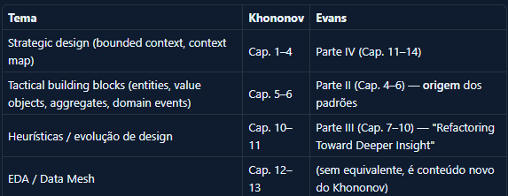

# Plano de Estudo — 4 Pilares

> **Filosofia**: lifelong learning — sem prazo, sem culpa, sem "atraso"  
> **Projeto âncora**: NexoMart Data Platform → open-source local → deploy AWS  
> **Canal**: cada pilar alimenta episódios e Clube do Livro

---

## Os 4 Pilares

```
┌──────────────────┐  ┌──────────────────────┐
│   PILAR 1        │  │   PILAR 2            │
│   AWS            │  │   Databricks / Spark │
│                  │  │                      │
│  Infraestrutura  │  │  Processamento       │
│  gerenciada +    │  │  distribuído +       │
│  serviços dados  │  │  Delta Lake nativo   │
└──────────────────┘  └──────────────────────┘

┌──────────────────┐  ┌──────────────────────┐
│   PILAR 3        │  │   PILAR 4            │
│   Python + SQL   │  │   Leituras           │
│                  │  │                      │
│  Código fluente  │  │  Teoria que          │
│  + analytics     │  │  fundamenta os       │
│  SQL avançado    │  │  outros 3 pilares    │
└──────────────────┘  └──────────────────────┘
```

---

## Rotina Base (lifelong, sustentável)

```
SEGUNDA a QUINTA  (15–20 min — quando der)
  → Leitura ou vídeo do pilar da semana
  → Uma anotação de conexão com o projeto NexoMart

SÁBADO  (2–3h — bloco principal, não negociável)
  → 1h30: estudo ativo (leitura, laboratório, exercício)
  → 30min: síntese — anotar o que aprendeu + conexão com o projeto
  → Resultado: rascunho de roteiro do canal ou nota técnica

DOMINGO  (1h — opcional, bônus)
  → Laboratório prático ou exercícios hands-on
  → Avançar no projeto com o conceito da semana

MÍNIMO SUSTENTÁVEL: 2h no sábado
CADÊNCIA: alterne pilares semana a semana — nunca fique mais de 2 semanas
          no mesmo pilar sem fazer pelo menos 30min de outro
```

### As 3 Perguntas de Síntese (universal, para todo pilar)

> **1. Onde esse conceito aparece no projeto NexoMart — agora ou no futuro?**  
> **2. Se eu não soubesse isso, onde teria errado na implementação?**  
> **3. Uma frase. O que eu diria a um colega sobre isso em 15 segundos?**

---

## Pilar 1 — AWS

**Meta profissional**: operar, deployar e aplicar IA na plataforma NexoMart em AWS  
**Meta de certificação**: SAA-C03 → DEA-C01 → AIF-C01 → MLA-C01  
**Projeto prático**: migrar NexoMart do ambiente local (Docker) para AWS com Terraform + adicionar camada de IA (Bedrock + SageMaker)

### Mapa: Stack Open-Source → Equivalente AWS

| Componente (local) | Equivalente AWS | Maturidade para usar |
|-------------------|-----------------|---------------------|
| MinIO | Amazon S3 | Direto — mesma API S3 |
| Hive Metastore | AWS Glue Data Catalog | Alto — mesmo conceito |
| Apache Spark (local) | Amazon EMR / EMR Serverless | Alto |
| Apache Kafka (local) | Amazon MSK | Direto |
| Apache Airflow (local) | Amazon MWAA | Direto |
| Trino | Amazon Athena v3 | Alto — Athena usa Trino |
| Unity Catalog OSS | AWS Lake Formation | Conceitual |
| Iceberg no MinIO | Iceberg no S3 + Glue Catalog | Nativo no Athena v3 |
| FastAPI local | ECS Fargate / Lambda | Arquitetural |

### Trilha de Estudo

**Fase A — Fundamentos (base para tudo)**

| Serviço / Conceito | Por que importa | Recurso |
|--------------------|-----------------|---------|
| IAM (roles, policies, STS, assume-role) | Sem IAM não existe nada seguro | AWS Skill Builder + Cantrill |
| S3 (particionamento, lifecycle, encryption, ACLs) | É o MinIO em produção — toda a data lake vive aqui | AWS Skill Builder |
| VPC (subnets, SGs, NAT, VPC endpoints) | Isolamento da plataforma analítica | Cantrill SAA-C03 |
| CloudWatch + CloudTrail | Observabilidade e auditoria | AWS Skill Builder |
| CloudFormation / CDK / Terraform | IaC — você não clica no console em produção | Terraform docs + TF AWS Provider |
| KMS | Criptografia em repouso (S3, RDS, EMR) | AWS docs |

**Fase B — AWS para Dados (DEA-C01)**

| Serviço | Conceito crítico para o projeto |
|---------|--------------------------------|
| S3 avançado | S3 Select, S3 Inventory, S3 Intelligent-Tiering |
| AWS Glue ETL + Data Catalog | Crawlers, partições, schema evolution, DPUs e custo |
| Amazon EMR | Cluster vs Serverless, bootstrap, spot instances, cost |
| Amazon EMR + Spark | PySpark no EMR — o mesmo código que você já escreve |
| Amazon MSK | Kafka gerenciado — quando usar vs Kinesis |
| Amazon Kinesis | Data Streams vs Firehose vs Analytics |
| Amazon Athena v3 | Iceberg nativo, workgroups, data lakehouse sem cluster |
| AWS Lake Formation | Fine-grained access, tag-based policies, LF-Tags |
| Amazon Redshift | Spectrum (lê S3), RA3, Serverless, integração Glue |
| AWS DMS | CDC do PostgreSQL — extração incremental |
| Amazon MWAA | Airflow gerenciado — custo, DAGs em S3, variáveis |

**Fase C — Projeto: NexoMart na AWS**

| Etapa | O que fazer | Serviços |
|-------|-------------|----------|
| 1 | Data lake no S3 (landing/bronze/silver/gold) | S3, Glue Catalog, Lake Formation, IAM |
| 2 | PostgreSQL → RDS Aurora (migração) | RDS, DMS, VPC, Security Groups |
| 3 | Spark jobs → Glue ou EMR Serverless | Glue, EMR, IAM roles, S3 |
| 4 | Athena como Trino (queries federadas Iceberg) | Athena, S3, Glue Catalog |
| 5 | Airflow local → MWAA | MWAA, S3, VPC, IAM |
| 6 | Kafka local → MSK | MSK, VPC, Lambda, IAM |
| 7 | Monitoramento | CloudWatch, X-Ray, SNS, Cost Explorer |
| 8 | IaC completo | Terraform, GitHub Actions, S3 backend |

**Fase D — AWS para IA (AIF-C01 → MLA-C01)**

| Serviço / Conceito | O que é | Conexão com o NexoMart |
|-------------------|---------|------------------------|
| Amazon Bedrock | Foundation models gerenciados (Claude, Titan, Llama) + RAG nativo | RAG sobre catálogo de produtos — busca semântica sem vector DB próprio |
| Amazon SageMaker Studio | IDE cloud para ML — notebooks, training, deploy | Treinar modelo de recomendação de produtos |
| SageMaker Feature Store | Armazenamento de features para ML online/offline | Features derivadas de fact_sales → enriquecer recomendações |
| SageMaker Pipelines | MLOps — pipelines de treinamento automatizados | Substituir Airflow para workflows de ML |
| SageMaker Model Registry | Versionamento e aprovação de modelos | Governança de modelos de fraude e recomendação |
| SageMaker Endpoints | Deploya modelos como API REST (real-time + batch) | Inference endpoint de recomendação para a API FastAPI |
| Amazon OpenSearch (k-NN) | Vector search gerenciado | Substitui pgvector em produção AWS |
| Amazon Bedrock Knowledge Bases | RAG gerenciado sobre S3 + vector store | Busca semântica no catálogo NexoMart sem infraestrutura |
| Amazon Bedrock Agents | LLM com tools — agentes autônomos | Agente de analytics sobre os dados do NexoMart |
| Amazon Rekognition | Análise de imagem gerenciada | Classificação automática de imagens de produto |
| Amazon Comprehend | NLP gerenciado — sentimento, entidades | Análise de reviews de produtos |
| Amazon Kendra | Enterprise search com ML | Alternativa ao OpenSearch para busca por texto |
| AWS Lambda + API Gateway | Serverless inference e orquestração | Endpoint de inferência leve sem servidor permanente |
| Amazon Q Developer | AI assistant para código e AWS | Acelerador de desenvolvimento e debugging |

### Recursos AWS

| Recurso | Tipo | Custo | Prioridade |
|---------|------|-------|-----------|
| AWS Skill Builder — Data Engineer Learning Plan | Plataforma oficial | Gratuito | Alta |
| AWS Skill Builder — AI/ML Learning Plan | Plataforma oficial | Gratuito | Alta |
| Adrian Cantrill SAA-C03 (cantrill.io) | Curso em vídeo | ~$40 | Alta — melhor base técnica |
| Stephane Maarek DEA-C01 (Udemy) | Curso em vídeo | ~$15 promoção | Alta — foco dados |
| Stephane Maarek AIF-C01 (Udemy) | Curso em vídeo | ~$15 promoção | Alta — IA foundational |
| AWS Certified Machine Learning Engineer Study Guide | Livro (Sybex/O'Reilly) | Pago | Média — MLA-C01 |
| AWS Well-Architected Framework + Machine Learning Lens | Whitepaper | Gratuito | Média |
| Terraform AWS Provider + registry | Documentação | Gratuito | Alta — IaC obrigatório |
| AWS Free Tier + AWS Sandbox | Laboratório | Gratuito | Alta — pratique tudo |
| Amazon Bedrock Workshop (workshop.aws) | Lab oficial | Gratuito | Alta — hands-on Bedrock |
| SageMaker Immersion Day | Lab oficial | Gratuito | Alta — hands-on SageMaker |

### Certificações (em ordem)

```
1. AWS Solutions Architect – Associate (SAA-C03)
   → Fundação sólida — IAM, VPC, S3, EC2, RDS, arquitetura
   → Muito cobrado em entrevistas técnicas e processos seletivos
   → Recurso: Cantrill SAA-C03

2. AWS Certified Data Engineer – Associate (DEA-C01)
   → Glue, EMR, Athena, Kinesis, MSK, Lake Formation, Redshift, DMS
   → Específico para a carreira — todos os serviços de dados
   → Recurso: Maarek DEA-C01 (Udemy)

3. AWS Certified AI Practitioner (AIF-C01)
   → Conceitos de IA/ML, serviços AWS AI, Bedrock, SageMaker overview
   → Foundational — não exige matemática de ML, foco em serviços e casos de uso
   → Recurso: Maarek AIF-C01 + AWS Skill Builder AI/ML path

4. AWS Certified Machine Learning Engineer – Associate (MLA-C01)
   → SageMaker profundo (Studio, Pipelines, Feature Store, Endpoints)
   → MLOps, deploy, monitoramento de modelos em produção
   → Recurso: AWS Skill Builder ML Engineer path + SageMaker docs
```

**Conexão IA → NexoMart (projeto real para cada cert)**

| Cert | Projeto prático no NexoMart |
|------|-----------------------------|
| AIF-C01 | Implementar RAG sobre catálogo com Bedrock Knowledge Bases (S3 → Bedrock → API) |
| MLA-C01 | Treinar modelo de recomendação no SageMaker, deploya como endpoint, consumir da FastAPI |

---

## Pilar 2 — Databricks / Spark

**Meta profissional**: dominar PySpark e o ecossistema Databricks em nível profissional  
**Meta de certificação**: Fundamentals → Spark Developer → Data Engineer Associate → Data Engineer Professional  
**Projeto prático**: reproduzir e otimizar o pipeline NexoMart completo no Databricks Community Edition

### Por que Databricks?

- Empresa por trás do Delta Lake e co-criadora do Apache Spark
- Unity Catalog que você usa no projeto = versão OSS do Unity Catalog do Databricks
- Delta Lake que você removeu do projeto = nativo no Databricks (Iceberg também)
- Databricks é o ambiente onde 80% das empresas que usam Spark operam em produção
- Certificação Databricks é muito valorizada junto com AWS no mercado

### Conteúdo por Subtópico

**Spark Core (você já sabe — aprofundar)**

| Conceito | O que você já tem | O que aprofundar |
|----------|------------------|------------------|
| DataFrames e transformações | Sim — nos jobs do projeto | Catalyst optimizer, physical plans, EXPLAIN |
| Particionamento | Parcial | repartition vs coalesce, partitionBy na escrita |
| Spark SQL | Sim — nos silver/gold scripts | Broadcast joins, AQE (Adaptive Query Execution) |
| Structured Streaming | Não | Triggers, watermark, stateful operations |
| PySpark avançado | Não | UDFs, pandas UDFs, Arrow, mapInPandas |

**Delta Lake / Iceberg (você já usa Iceberg)**

| Conceito | Foco |
|----------|------|
| Delta Lake internals | Transaction log (_delta_log), checkpoints, versioning |
| Delta Lake vs Iceberg | Trade-offs reais — você tomou essa decisão, agora entende a teoria |
| MERGE INTO (upserts) | Padrão SCD2 no Delta/Iceberg — crítico para dimensões |
| Z-Ordering e file compaction | Performance em leitura analítica |
| Change Data Feed | CDC nativo do Delta — alimenta streaming |
| Iceberg v2 (row-level deletes) | O que você usa agora — entender os format-version |

**Databricks Platform (Associate → Professional)**

| Componente | Nível | O que é | Aparece em |
|------------|-------|---------|------------|
| Databricks Lakehouse | Associate | Delta Lake + Unity Catalog + Spark gerenciado | Todo o pipeline |
| Unity Catalog (Databricks) | Associate / Professional | Governança + lineage + fine-grained access | Você usa a versão OSS |
| Delta Live Tables (DLT) | Associate / Professional | Pipelines declarativas com qualidade embutida | Substitui Airflow + Spark jobs |
| Auto Loader | Associate | Ingestão incremental do S3/ADLS com schema evolution | Substitui landing jobs |
| Databricks SQL | Associate | SQL warehouse sobre Delta/Iceberg | Substitui Trino local |
| MLflow | Associate / Professional | Tracking, Model Registry e serving | Camada de AI do NexoMart |
| Databricks Workflows | Professional | Orquestração multi-task nativa | Substitui Airflow DAGs |
| Liquid Clustering | Professional | Particionamento adaptativo (substitui Z-Order manual) | Otimização Gold layer |
| Delta Lake avançado | Professional | Shallow/deep clone, VACUUM, time travel, CDF | Governança e auditoria |
| Structured Streaming avançado | Professional | Stateful operations, late data, idempotency, triggers | Kafka → Iceberg streaming |
| Databricks Asset Bundles (DAB) | Professional | IaC para Databricks — deployar notebooks e jobs | CI/CD do pipeline |
| Photon Engine | Professional | Runtime acelerado (3–10x vs Spark padrão) | Performance Gold layer |

**Spark Core Profundo (Spark Developer cert)**

| Conceito | O que dominar |
|----------|--------------|
| Arquitetura interna | Driver vs Executor, stages vs tasks, DAG scheduler, shuffle write/read |
| Catalyst Optimizer | Logical plan → Physical plan → CodeGen — ler o EXPLAIN EXTENDED |
| Adaptive Query Execution (AQE) | Como o Spark reotimiza em runtime — skew join, coalesce pós-shuffle |
| Joins | Broadcast (BHJ), Sort-Merge (SMJ), Shuffle Hash — quando usar cada um |
| Particionamento | repartition vs coalesce, partitionBy na escrita, skew handling |
| Caching | cache() vs persist(), storage levels (MEMORY_AND_DISK, OFF_HEAP) |
| UDFs | Por que UDF é lento, pandas UDF com Arrow, mapInPandas sem overhead |
| Broadcast variables + Accumulators | Compartilhar dados read-only e acumular métricas |
| Spark UI | Ler DAG, identificar gargalos por stage, spill to disk, GC time |
| RDD API | createRDD, map/filter/reduce — base do DataFrame API |
| Streaming (basics) | readStream/writeStream, triggers, checkpointing |

### Recursos Databricks

| Recurso | Tipo | Custo | Prioridade |
|---------|------|-------|-----------|
| Databricks Academy (academy.databricks.com) | Plataforma oficial | Gratuito | Alta |
| Databricks Community Edition | Ambiente prático | Gratuito | Alta — laboratório |
| Databricks Fundamentals Accreditation | Certificado gratuito | Gratuito | Alta — faz primeiro |
| "Delta Lake: The Definitive Guide" (O'Reilly) | Livro | Pago | Alta — Associate + Professional |
| "Spark: The Definitive Guide" (Chambers & Zaharia) | Livro | Pago | Alta — Spark Developer |
| Databricks docs — DLT + Unity Catalog + DAB | Documentação | Gratuito | Alta |
| Databricks Learning — Data Engineer Professional prep | Plataforma oficial | Pago (assinatura) | Alta — Professional |
| YouTube: Advancing Analytics (Simon Whiteley) | Canal | Gratuito | Média — casos reais |
| Data + AI Summit sessions (YouTube) | Vídeos | Gratuito | Média — cases avançados |

### Certificações Databricks (em ordem)

```
1. Databricks Fundamentals Accreditation
   → Gratuito, online, ~2h de estudo
   → Faz primeiro — valida o vocabulário de toda a trilha

2. Databricks Certified Associate Developer for Apache Spark
   → Spark Core: DataFrames, SQL, joins, particionamento, caching, Spark UI
   → Prova com código Python ao vivo (tempo limitado)
   → 4–6 semanas — estuda com Spark: The Definitive Guide + exercícios práticos

3. Databricks Certified Data Engineer Associate
   → Delta Lake + Auto Loader + DLT básico + Unity Catalog + MLflow intro
   → 4–6 semanas após Spark Developer (aproveita o momentum)

4. Databricks Certified Data Engineer Professional
   → DLT avançado + Workflows + Liquid Clustering + Streaming stateful + DAB + MLflow avançado
   → A mais difícil da trilha — exige projeto real funcionando
   → 8–12 semanas — estude com os labs do Databricks Academy + projeto NexoMart
```

**Diferença Associate → Professional em um parágrafo**

O Associate valida que você conhece a plataforma e consegue construir pipelines funcionais. O Professional valida que você consegue otimizar, operar e governar pipelines em produção — custo, performance, idempotência, CI/CD e recovery. A pergunta do Professional não é "funciona?", é "funciona em escala, com falha parcial, com rollback, com custo controlado?"

---

## Pilar 3 — Python + SQL

**Meta profissional**: escrever código Python de plataforma de dados — fluente, tipado, testado  
**Meta SQL**: dominar SQL analítico — window functions, CTEs, otimização, e dialetos Spark/Trino

### Python — Subtópicos

**Python de Plataforma (você já tem base — aprofundar)**

| Subtópico | Foco | Onde aparece no projeto |
|-----------|------|------------------------|
| Async + asyncio | Coroutines, event loop, gather, async generators | FastAPI + asyncpg + seeders |
| Type hints + Pydantic v2 | Modelos tipados, validators, discriminated unions | Schemas da API |
| Generators e itertools | yield, send, lazy evaluation, pipelines | Seeders em bulk |
| Protocolos e ABCs | Duck typing formal, interfaces implícitas | Repositories |
| Dataclasses vs Pydantic | Quando usar cada um em data engineering | Configs e schemas |
| pytest + fixtures | Testes de integração na API | dbapi/api/tests/ |
| uv + ruff | Gerenciamento de ambiente e linting moderno | Já usa no projeto |
| Logging estruturado | structlog vs logging — JSON logs para CloudWatch | Todos os jobs Spark |

**OOP Fundamentos: Lutz → Fluent Python (leitura pareada)**

Mesma lógica do Clube T3 (Evans → Khononov): livro de fundamentos primeiro, tratamento
idiomático/avançado depois. Ler em blocos temáticos, não em paralelo capítulo a capítulo.

| Bloco | Learning Python — Lutz (fundamentos) | Fluent Python — Ramalho (idiomático) |
|-------|--------------------------------------|----------------------------------------|
| 1. OOP básico | Cap. 26–28 — OOP: The Big Picture, Class Coding Basics/Details | Cap. 11 — A Pythonic Object |
| 2. Sobrecarga de operadores | Cap. 29 — Operator Overloading | Cap. 12 + 16 — Special Methods for Sequences, Operator Overloading |
| 3. Design com classes | Cap. 30 — Designing with Classes (herança, composição) | Cap. 14 — Inheritance: For Better or Worse |
| 4. Tópicos avançados | Cap. 31 — Advanced Class Topics (slots, properties, descriptors, metaclasses) | Cap. 13 — Interfaces, Protocols, and ABCs |

> Confirme os números de capítulo contra o sumário da sua edição do Lutz (variam um
> pouco entre a 4ª e a 5ª). O Bloco 4 fecha direto no Fluent Python cap. 13, que já
> está mapeado abaixo nos Recursos e no Clube T6.

**PySpark (Python + Spark — cobre os dois pilares)**

| Subtópico | Foco |
|-----------|------|
| Schema inference vs declarado | Evitar surpresas em produção |
| pandas UDFs com Arrow | Performance em UDFs complexas |
| Column expressions vs lambda | Por que `.withColumn(col(...))` é melhor que UDF |
| Broadcast variables + accumulators | Otimização de joins grandes |
| SparkContext vs SparkSession | O que está por baixo |

### SQL — Subtópicos

**SQL Analítico (fundação)**

| Conceito | Onde pratica | Nível atual |
|----------|-------------|-------------|
| Window Functions (ROW_NUMBER, LAG, LEAD, NTILE, SUM OVER) | Trino + Spark SQL + PostgreSQL | Parcial — aprofundar |
| CTEs e CTEs recursivas | Hierarquia de categorias, árvores | Parcial |
| Materialized Views | PostgreSQL + Redshift | Básico |
| Query optimization (EXPLAIN, planos de execução) | PostgreSQL EXPLAIN ANALYZE | Parcial |
| Particionamento e Partition Pruning | PostgreSQL + Spark | Parcial |
| Índices avançados (GIN, BRIN, Expression) | PostgreSQL | Conhece — aprofundar |

**SQL de Plataforma (Delta/Iceberg/Spark SQL)**

| Conceito | Foco |
|----------|------|
| MERGE INTO (upsert) | Padrão crítico para SCDs e deduplicação |
| Time Travel (AT VERSION / AT TIMESTAMP) | Delta e Iceberg — debug e auditoria |
| COPY INTO / Auto Loader SQL | Ingestão incremental no Databricks |
| Spark SQL dialeto vs ANSI SQL | O que é portável, o que não é |
| dbt (data build tool) | SQL modularizado + testes + docs + lineage |

**dbt — vale estudar separado**

| Aspecto | Por que importa |
|---------|-----------------|
| dbt Core + dbt Cloud | Transforma Silver → Gold com SQL versionado |
| Models, Sources, Seeds | Organização do projeto de transformação |
| Tests (not_null, unique, relationships) | Qualidade de dados automatizada |
| Lineage graph | Visualiza o fluxo de dados de ponta a ponta |
| dbt + Spark (dbt-spark) | Corre sobre Databricks ou EMR |
| dbt + Trino (dbt-trino) | Corre sobre Athena ou Trino local |

### Recursos Python + SQL

| Recurso | Tipo | Custo | Prioridade |
|---------|------|-------|-----------|
| Fluent Python — Ramalho (caps 13, 17, 21) | Livro | Pago | Alta |
| Learning Python — Mark Lutz (Parte VI, caps 26–31) | Livro | Pago | Alta — fundamentos OOP antes do Fluent Python |
| Python Docs — asyncio | Documentação | Gratuito | Alta |
| Mode Analytics SQL Tutorial | Plataforma online | Gratuito | Alta — SQL analítico |
| dbt Learn (courses.getdbt.com) | Plataforma oficial | Gratuito | Alta |
| "Spark: The Definitive Guide" | Livro | Pago | Alta — PySpark profundo |
| SQLZoo + StrataScratch | Prática SQL | Gratuito | Média — exercícios |
| pgexercises.com | Prática PostgreSQL | Gratuito | Média |

---

## Pilar 4 — Leituras

Os livros não são um pilar isolado — eles fundamentam e enriquecem os outros três. A tabela abaixo mostra **qual pilar cada livro alimenta**.

| Livro | Pilar principal | Pilar secundário | Canal |
|-------|----------------|-----------------|-------|
| Kimball — Data Warehouse Toolkit | Python + SQL (modelagem) | Databricks/Spark (Gold Layer) | Clube T0 |
| Fundamentos de Engenharia de Dados | Databricks/Spark (ciclo de vida) | AWS (mapa de serviços) | Clube T1 |
| DDIA — Kleppmann | AWS (distribuídos) | Databricks/Spark (storage) | Clube T2 |
| DDD Evans | Python + SQL (domínios) | — | base T3.1–T3.4 |
| Learning DDD — Khononov | Python + SQL (Outbox, CQRS) | AWS (EventBridge, SQS) | Clube T3.1–T3.4 |
| Hard Parts — Ford & Richards | AWS (decomposição) | Databricks/Spark (CQRS) | Clube T4 |
| GoF — Design Patterns | Python + SQL (padrões de código) | — | Clube T5 |
| Fluent Python — Ramalho | Python + SQL (Python profundo) | Databricks/Spark (PySpark) | Clube T6 |

### Sequência de Leitura (por ordem de fundação)

```
BLOCO 1 — Base de Dados e Engenharia
  1. Kimball (Caps 1–4)              → star schema do NexoMart
  2. Fundamentos DE (caps selecionados)  → vocabulário do ciclo de vida

BLOCO 2 — Sistemas Distribuídos
  3. DDIA (Caps 3–4 + 11)            → por dentro do Spark e Kafka

BLOCO 3 — Design de Domínio
  4. DDD Evans (Pts I + II + IV)     → teoria — leia devagar
  5. Khononov (Caps 1–6 + 10)        → prática — Outbox, eventos
     → Clube T3 expandido em 4 sub-episódios (T3.1–T3.4), pareando
       Evans + Khononov por tema em vez de um único episódio.
       Detalhamento completo: ESTRATEGIA_CONSOLIDADA_CONTEUDO.md

BLOCO 4 — Arquitetura e Padrões
  6. Hard Parts (Caps 1–4 + 6 + 9)   → CQRS, trade-offs
  7. GoF (intro + 4 padrões)         → nomear o que você já faz

BLOCO 5 — Python Profundo
  8. Fluent Python (Caps 13 + 17 + 21)  → async, generators, protocols
```

### Capítulos por Livro (o que ler de cada um)

#### Kimball — The Data Warehouse Toolkit
| Cap | Tema | Páginas |
|-----|------|---------|
| 1 | Dimensional Modeling Primer | ~35p |
| 2 | Retail Sales (análogo ao NexoMart) | ~35p |
| 3 | Inventory | ~25p |
| 4 | Procurement | ~25p |

#### Fundamentos de Engenharia de Dados (Reis & Housley)
| Cap | Tema | Páginas |
|-----|------|---------|
| 1 + 2 | Ciclo de vida + Undercurrents | ~60p |
| 3 | Projetando boas arquiteturas | ~40p |
| 8 | Queries, Modelagem e Transformações | ~50p |
| 9 | Ingestão | ~40p |

#### DDIA — Kleppmann
| Cap | Tema | Páginas |
|-----|------|---------|
| 3 | Storage and Retrieval (LSM-Tree, B-Tree, columnar) | ~35p |
| 4 | Encoding and Evolution (schema evolution) | ~25p |
| 11 | Stream Processing — o mais importante para a stack | ~45p |

#### DDD Evans
| Parte/Cap | Tema | Páginas |
|-----------|------|---------|
| Parte I (caps 1–3) | Ubiquitous Language + modelo para trabalhar | ~60p |
| Parte II (caps 5–7) | Entities, Value Objects, Aggregates, Repositories | ~90p |
| Parte IV (caps 14–15) | Strategic Design — Context Map, Bounded Contexts | ~70p |

#### Learning DDD — Khononov
| Cap | Tema | Páginas |
|-----|------|---------|
| 1–2 | Analyzing Business Domains + Domain Knowledge | ~40p |
| 3–4 | Managing Complexity + Bounded Contexts | ~40p |
| 5 | Implementing Aggregates | ~40p |
| 10 | Design Patterns (Outbox, Saga, CQRS) | ~60p |

#### Hard Parts — Ford & Richards
| Cap | Tema | Páginas |
|-----|------|---------|
| 1–2 | As partes difíceis + encontrando limites | ~40p |
| 3–4 | Decomposição — granularidade, drivers | ~50p |
| 6 | Pulling Apart Operational Data | ~30p |
| 9 | Distributed Data Access (CQRS, data mesh) | ~40p |

#### GoF — Design Patterns
| Padrão | Páginas |
|--------|---------|
| Introdução + Catalog (obrigatório) | ~30p |
| Repository / Proxy / Façade | ~20p |
| Factory Method + Abstract Factory | ~25p |
| Observer / Event | ~20p |

#### Fluent Python — Ramalho
| Cap | Tema | Páginas |
|-----|------|---------|
| 13 | Protocols and ABCs | ~35p |
| 17 | Iterators and Generators | ~40p |
| 21 | Asynchronous Programming | ~55p |

---

## Visão de Rotação Semanal (sugestão)

Você não precisa terminar um pilar para começar outro. A rotação mantém o ritmo sem saturar:

```
SEMANA A: Leitura (Pilar 4) + aplicação no projeto
SEMANA B: AWS — lab prático no console / Terraform
SEMANA C: Databricks — notebook no Community Edition
SEMANA D: Python + SQL — exercício, refatoração de código, dbt

Repete. Sem prazo. Sem sprint. Sem burnout.
```

Quando uma leitura fundamenta diretamente um dos outros pilares (ex: DDIA cap 3 → Spark storage), faça as duas semanas juntas: leia + faça o laboratório correspondente.

---

## Conexão com os ADRs do Projeto

| ADR | Decisão | Pilar | Livro / Recurso |
|-----|---------|-------|-----------------|
| ADR-001 | SQLAlchemy async + bulk insert sem for-loops | Python + SQL | Fluent Python caps 17 + 21 |
| ADR-002 | Iceberg + Unity Catalog para governança | Databricks/Spark | DDIA cap 3 + Databricks docs |
| ADR-003 | Modelagem dimensional (star schema) | Python + SQL | Kimball caps 1–4 |
| ADR-004 | Kafka como buffer entre API e storage | AWS / Databricks | DDIA cap 11 |
| ADR-005 | Outbox Pattern para exactly-once com Kafka | Python + SQL | Khononov cap 10 |
| ADR-006 | CQRS com Trino para separar read/write paths | AWS | Hard Parts caps 6 + 9 |
| ADR-007 | Arquitetura 3-layer (Repository/Service/Router) | Python + SQL | Evans Pt II + GoF |
| ADR-008 | Deploy AWS com IaC (Terraform) | AWS | DEA-C01 + Cantrill SAA-C03 |

---



## Regras para Não Abandonar

1. **Sem prazo = sem atraso.** Nenhuma fase tem deadline. Cada página, lab ou exercício é progresso real.
2. **Mínimo sustentável**: 2h no sábado — suficiente para não perder o ritmo.
3. **Se uma semana falhar**: continue de onde parou. Não tente "recuperar" — isso gera culpa e abandono.
4. **Rotação é mais forte que profundidade forçada**: dois dias de AWS + dois dias de Spark > quatro dias de AWS com saturação.
5. **AWS e Databricks exigem laboratório** — conte o dobro do tempo estimado para qualquer prática hands-on.
6. **O projeto é a prova real**: se você consegue aplicar o conceito no NexoMart, aprendeu. Se não consegue, releia.
7. **Canal como deadline natural**: cada Clube do Livro que vai ao ar fecha a leitura daquele bloco — use isso como âncora.

---

*Documento criado em 2026-07-04 | Revisão: quando terminar um bloco ou os recursos mudarem*  
*Projeto âncora: Data Platform do Zero — NexoMart*
