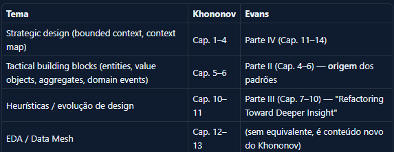

# Study Plan — 4 Pillars

> **Philosophy**: lifelong learning — no deadline, no guilt, no "falling behind"
> **Anchor project**: NexoMart Data Platform → open-source local → AWS deploy
> **Channel**: each pillar feeds episodes and the Book Club

---

## The 4 Pillars

```
┌──────────────────┐  ┌──────────────────────┐
│   PILLAR 1        │  │   PILLAR 2            │
│   AWS             │  │   Databricks / Spark  │
│                  │  │                      │
│  Managed          │  │  Distributed          │
│  infrastructure +  │  │  processing +         │
│  data services     │  │  native Delta Lake    │
└──────────────────┘  └──────────────────────┘

┌──────────────────┐  ┌──────────────────────┐
│   PILLAR 3        │  │   PILLAR 4            │
│   Python + SQL    │  │   Reading             │
│                  │  │                      │
│  Fluent code      │  │  Theory that          │
│  + advanced        │  │  grounds the          │
│  analytics SQL     │  │  other 3 pillars      │
└──────────────────┘  └──────────────────────┘
```

---

## Base Routine (lifelong, sustainable)

```
MONDAY to THURSDAY  (15–20 min — whenever possible)
  → Reading or video from the week's pillar
  → One note connecting it to the NexoMart project

SATURDAY  (2–3h — main block, non-negotiable)
  → 1h30: active study (reading, lab, exercise)
  → 30min: synthesis — write down what you learned + connection to the project
  → Result: a channel script draft or technical note

SUNDAY  (1h — optional, bonus)
  → Practical lab or hands-on exercises
  → Advance the project with the week's concept

SUSTAINABLE MINIMUM: 2h on Saturday
CADENCE: rotate pillars week to week — never spend more than 2 weeks
          on the same pillar without at least 30min of another
```

### The 3 Synthesis Questions (universal, for every pillar)

> **1. Where does this concept show up in the NexoMart project — now or in the future?**
> **2. If I didn't know this, where would I have gotten the implementation wrong?**
> **3. One sentence. What would I tell a colleague about this in 15 seconds?**

---

## Pillar 1 — AWS

**Professional goal**: operate, deploy, and apply AI on the NexoMart platform on AWS
**Certification goal**: SAA-C03 → DEA-C01 → AIF-C01 → MLA-C01
**Practical project**: migrate NexoMart from the local environment (Docker) to AWS with Terraform + add an AI layer (Bedrock + SageMaker)

### Map: Open-Source Stack → AWS Equivalent

| Component (local) | AWS equivalent | Maturity to use |
|-------------------|-----------------|---------------------|
| MinIO | Amazon S3 | Direct — same S3 API |
| Hive Metastore | AWS Glue Data Catalog | High — same concept |
| Apache Spark (local) | Amazon EMR / EMR Serverless | High |
| Apache Kafka (local) | Amazon MSK | Direct |
| Apache Airflow (local) | Amazon MWAA | Direct |
| Trino | Amazon Athena v3 | High — Athena uses Trino |
| Hive Metastore | AWS Glue Data Catalog | Direct |
| Iceberg on MinIO | Iceberg on S3 + Glue Catalog | Native in Athena v3 |
| Local FastAPI | ECS Fargate / Lambda | Architectural |

### Study Track

**Phase A — Fundamentals (base for everything)**

| Service / Concept | Why it matters | Resource |
|--------------------|-----------------|---------|
| IAM (roles, policies, STS, assume-role) | Without IAM nothing is secure | AWS Skill Builder + Cantrill |
| S3 (partitioning, lifecycle, encryption, ACLs) | It's MinIO in production — the whole data lake lives here | AWS Skill Builder |
| VPC (subnets, SGs, NAT, VPC endpoints) | Isolation for the analytics platform | Cantrill SAA-C03 |
| CloudWatch + CloudTrail | Observability and auditing | AWS Skill Builder |
| CloudFormation / CDK / Terraform | IaC — you don't click around the console in production | Terraform docs + TF AWS Provider |
| KMS | Encryption at rest (S3, RDS, EMR) | AWS docs |

**Phase B — AWS for Data (DEA-C01)**

| Service | Concept critical for the project |
|---------|--------------------------------|
| Advanced S3 | S3 Select, S3 Inventory, S3 Intelligent-Tiering |
| AWS Glue ETL + Data Catalog | Crawlers, partitions, schema evolution, DPUs and cost |
| Amazon EMR | Cluster vs Serverless, bootstrap, spot instances, cost |
| Amazon EMR + Spark | PySpark on EMR — the same code you already write |
| Amazon MSK | Managed Kafka — when to use it vs Kinesis |
| Amazon Kinesis | Data Streams vs Firehose vs Analytics |
| Amazon Athena v3 | Native Iceberg, workgroups, clusterless data lakehouse |
| AWS Lake Formation | Fine-grained access, tag-based policies, LF-Tags |
| Amazon Redshift | Spectrum (reads S3), RA3, Serverless, Glue integration |
| AWS DMS | CDC from PostgreSQL — incremental extraction |
| Amazon MWAA | Managed Airflow — cost, DAGs in S3, variables |

**Phase C — Project: NexoMart on AWS**

| Step | What to do | Services |
|-------|-------------|----------|
| 1 | Data lake on S3 (landing/bronze/silver/gold) | S3, Glue Catalog, Lake Formation, IAM |
| 2 | PostgreSQL → RDS Aurora (migration) | RDS, DMS, VPC, Security Groups |
| 3 | Spark jobs → Glue or EMR Serverless | Glue, EMR, IAM roles, S3 |
| 4 | Athena as Trino (federated Iceberg queries) | Athena, S3, Glue Catalog |
| 5 | Local Airflow → MWAA | MWAA, S3, VPC, IAM |
| 6 | Local Kafka → MSK | MSK, VPC, Lambda, IAM |
| 7 | Monitoring | CloudWatch, X-Ray, SNS, Cost Explorer |
| 8 | Full IaC | Terraform, GitHub Actions, S3 backend |

**Phase D — AWS for AI (AIF-C01 → MLA-C01)**

| Service / Concept | What it is | Connection to NexoMart |
|-------------------|---------|------------------------|
| Amazon Bedrock | Managed foundation models (Claude, Titan, Llama) + native RAG | RAG over the product catalog — semantic search with no vector DB of your own |
| Amazon SageMaker Studio | Cloud IDE for ML — notebooks, training, deploy | Train a product recommendation model |
| SageMaker Feature Store | Feature storage for online/offline ML | Features derived from fact_sales → enrich recommendations |
| SageMaker Pipelines | MLOps — automated training pipelines | Replace Airflow for ML workflows |
| SageMaker Model Registry | Model versioning and approval | Governance for fraud and recommendation models |
| SageMaker Endpoints | Deploy models as a REST API (real-time + batch) | Recommendation inference endpoint for the FastAPI |
| Amazon OpenSearch (k-NN) | Managed vector search | Replaces pgvector in AWS production |
| Amazon Bedrock Knowledge Bases | Managed RAG over S3 + vector store | Semantic search over the NexoMart catalog with no infrastructure |
| Amazon Bedrock Agents | LLM with tools — autonomous agents | Analytics agent over NexoMart's data |
| Amazon Rekognition | Managed image analysis | Automatic classification of product images |
| Amazon Comprehend | Managed NLP — sentiment, entities | Product review analysis |
| Amazon Kendra | Enterprise search with ML | Alternative to OpenSearch for text search |
| AWS Lambda + API Gateway | Serverless inference and orchestration | Lightweight inference endpoint with no standing server |
| Amazon Q Developer | AI assistant for code and AWS | Development and debugging accelerator |

### AWS Resources

| Resource | Type | Cost | Priority |
|---------|------|-------|-----------|
| AWS Skill Builder — Data Engineer Learning Plan | Official platform | Free | High |
| AWS Skill Builder — AI/ML Learning Plan | Official platform | Free | High |
| Adrian Cantrill SAA-C03 (cantrill.io) | Video course | ~$40 | High — best technical base |
| Stephane Maarek DEA-C01 (Udemy) | Video course | ~$15 on sale | High — data focus |
| Stephane Maarek AIF-C01 (Udemy) | Video course | ~$15 on sale | High — foundational AI |
| AWS Certified Machine Learning Engineer Study Guide | Book (Sybex/O'Reilly) | Paid | Medium — MLA-C01 |
| AWS Well-Architected Framework + Machine Learning Lens | Whitepaper | Free | Medium |
| Terraform AWS Provider + registry | Documentation | Free | High — IaC mandatory |
| AWS Free Tier + AWS Sandbox | Lab | Free | High — practice everything |
| Amazon Bedrock Workshop (workshop.aws) | Official lab | Free | High — hands-on Bedrock |
| SageMaker Immersion Day | Official lab | Free | High — hands-on SageMaker |

### Certifications (in order)

```
1. AWS Solutions Architect – Associate (SAA-C03)
   → Solid foundation — IAM, VPC, S3, EC2, RDS, architecture
   → Heavily asked about in technical interviews and hiring processes
   → Resource: Cantrill SAA-C03

2. AWS Certified Data Engineer – Associate (DEA-C01)
   → Glue, EMR, Athena, Kinesis, MSK, Lake Formation, Redshift, DMS
   → Career-specific — every data service
   → Resource: Maarek DEA-C01 (Udemy)

3. AWS Certified AI Practitioner (AIF-C01)
   → AI/ML concepts, AWS AI services, Bedrock, SageMaker overview
   → Foundational — no ML math required, focused on services and use cases
   → Resource: Maarek AIF-C01 + AWS Skill Builder AI/ML path

4. AWS Certified Machine Learning Engineer – Associate (MLA-C01)
   → SageMaker in depth (Studio, Pipelines, Feature Store, Endpoints)
   → MLOps, deployment, monitoring models in production
   → Resource: AWS Skill Builder ML Engineer path + SageMaker docs
```

**AI → NexoMart connection (real project for each cert)**

| Cert | Practical NexoMart project |
|------|-----------------------------|
| AIF-C01 | Implement RAG over the catalog with Bedrock Knowledge Bases (S3 → Bedrock → API) |
| MLA-C01 | Train a recommendation model in SageMaker, deploy it as an endpoint, consume it from FastAPI |

---

## Pillar 2 — Databricks / Spark

**Professional goal**: master PySpark and the Databricks ecosystem at a professional level
**Certification goal**: Fundamentals → Spark Developer → Data Engineer Associate → Data Engineer Professional
**Practical project**: reproduce and optimize the full NexoMart pipeline on Databricks Community Edition

### Why Databricks?

- The company behind Delta Lake and a co-creator of Apache Spark
- Unity Catalog is Databricks' governance layer — the managed version you're adopting for the project
- The Delta Lake you removed from the project is native to Databricks (Iceberg too)
- Databricks is the environment where 80% of companies using Spark run in production
- The Databricks certification is highly valued alongside AWS in the job market

### Content by Subtopic

**Spark Core (you already know this — go deeper)**

| Concept | What you already have | What to go deeper on |
|----------|------------------|------------------|
| DataFrames and transformations | Yes — in the project's jobs | Catalyst optimizer, physical plans, EXPLAIN |
| Partitioning | Partial | repartition vs coalesce, partitionBy on write |
| Spark SQL | Yes — in the silver/gold scripts | Broadcast joins, AQE (Adaptive Query Execution) |
| Structured Streaming | No | Triggers, watermark, stateful operations |
| Advanced PySpark | No | UDFs, pandas UDFs, Arrow, mapInPandas |

**Delta Lake / Iceberg (you already use Iceberg)**

| Concept | Focus |
|----------|------|
| Delta Lake internals | Transaction log (_delta_log), checkpoints, versioning |
| Delta Lake vs Iceberg | Real trade-offs — you already made that call, now understand the theory |
| MERGE INTO (upserts) | SCD2 pattern in Delta/Iceberg — critical for dimensions |
| Z-Ordering and file compaction | Analytical read performance |
| Change Data Feed | Delta's native CDC — feeds streaming |
| Iceberg v2 (row-level deletes) | What you use now — understand the format-versions |

**Databricks Platform (Associate → Professional)**

| Component | Level | What it is | Shows up in |
|------------|-------|---------|------------|
| Databricks Lakehouse | Associate | Delta Lake + Unity Catalog + managed Spark | The whole pipeline |
| Unity Catalog (Databricks) | Associate / Professional | Governance + lineage + fine-grained access | Adopting the managed version |
| Delta Live Tables (DLT) | Associate / Professional | Declarative pipelines with built-in quality | Replaces Airflow + Spark jobs |
| Auto Loader | Associate | Incremental ingestion from S3/ADLS with schema evolution | Replaces landing jobs |
| Databricks SQL | Associate | SQL warehouse over Delta/Iceberg | Replaces local Trino |
| MLflow | Associate / Professional | Tracking, Model Registry, and serving | NexoMart's AI layer |
| Databricks Workflows | Professional | Native multi-task orchestration | Replaces Airflow DAGs |
| Liquid Clustering | Professional | Adaptive partitioning (replaces manual Z-Order) | Gold layer optimization |
| Advanced Delta Lake | Professional | Shallow/deep clone, VACUUM, time travel, CDF | Governance and auditing |
| Advanced Structured Streaming | Professional | Stateful operations, late data, idempotency, triggers | Kafka → Iceberg streaming |
| Databricks Asset Bundles (DAB) | Professional | IaC for Databricks — deploying notebooks and jobs | Pipeline CI/CD |
| Photon Engine | Professional | Accelerated runtime (3–10x vs standard Spark) | Gold layer performance |

**Deep Spark Core (Spark Developer cert)**

| Concept | What to master |
|----------|--------------|
| Internal architecture | Driver vs Executor, stages vs tasks, DAG scheduler, shuffle write/read |
| Catalyst Optimizer | Logical plan → Physical plan → CodeGen — reading EXPLAIN EXTENDED |
| Adaptive Query Execution (AQE) | How Spark re-optimizes at runtime — skew join, post-shuffle coalesce |
| Joins | Broadcast (BHJ), Sort-Merge (SMJ), Shuffle Hash — when to use each |
| Partitioning | repartition vs coalesce, partitionBy on write, skew handling |
| Caching | cache() vs persist(), storage levels (MEMORY_AND_DISK, OFF_HEAP) |
| UDFs | Why UDFs are slow, pandas UDF with Arrow, mapInPandas with no overhead |
| Broadcast variables + Accumulators | Sharing read-only data and accumulating metrics |
| Spark UI | Reading the DAG, spotting bottlenecks per stage, spill to disk, GC time |
| RDD API | createRDD, map/filter/reduce — the base of the DataFrame API |
| Streaming (basics) | readStream/writeStream, triggers, checkpointing |

### Databricks Resources

| Resource | Type | Cost | Priority |
|---------|------|-------|-----------|
| Databricks Academy (academy.databricks.com) | Official platform | Free | High |
| Databricks Community Edition | Practice environment | Free | High — lab |
| Databricks Fundamentals Accreditation | Free certificate | Free | High — do this first |
| "Delta Lake: The Definitive Guide" (O'Reilly) | Book | Paid | High — Associate + Professional |
| "Spark: The Definitive Guide" (Chambers & Zaharia) | Book | Paid | High — Spark Developer |
| Databricks docs — DLT + Unity Catalog + DAB | Documentation | Free | High |
| Databricks Learning — Data Engineer Professional prep | Official platform | Paid (subscription) | High — Professional |
| YouTube: Advancing Analytics (Simon Whiteley) | Channel | Free | Medium — real-world cases |
| Data + AI Summit sessions (YouTube) | Videos | Free | Medium — advanced case studies |

### Databricks Certifications (in order)

```
1. Databricks Fundamentals Accreditation
   → Free, online, ~2h of study
   → Do this first — validates the vocabulary for the whole track

2. Databricks Certified Associate Developer for Apache Spark
   → Spark Core: DataFrames, SQL, joins, partitioning, caching, Spark UI
   → Exam with live Python code (time-limited)
   → 4–6 weeks — study with Spark: The Definitive Guide + hands-on exercises

3. Databricks Certified Data Engineer Associate
   → Delta Lake + Auto Loader + basic DLT + Unity Catalog + MLflow intro
   → 4–6 weeks after Spark Developer (rides the momentum)

4. Databricks Certified Data Engineer Professional
   → Advanced DLT + Workflows + Liquid Clustering + stateful Streaming + DAB + advanced MLflow
   → The hardest in the track — requires a real, working project
   → 8–12 weeks — study with the Databricks Academy labs + the NexoMart project
```

**Associate → Professional difference in one paragraph**

The Associate validates that you know the platform and can build working pipelines. The Professional validates that you can optimize, operate, and govern pipelines in production — cost, performance, idempotency, CI/CD, and recovery. The Professional's question isn't "does it work?", it's "does it work at scale, under partial failure, with rollback, with cost under control?"

---

## Pillar 3 — Python + SQL

**Professional goal**: write data-platform Python code — fluent, typed, tested
**SQL goal**: master analytical SQL — window functions, CTEs, optimization, and the Spark/Trino dialects

### Python — Subtopics

**Platform Python (you already have a base — go deeper)**

| Subtopic | Focus | Where it shows up in the project |
|-----------|------|------------------------|
| Async + asyncio | Coroutines, event loop, gather, async generators | FastAPI + asyncpg + seeders |
| Type hints + Pydantic v2 | Typed models, validators, discriminated unions | API schemas |
| Generators and itertools | yield, send, lazy evaluation, pipelines | Bulk seeders |
| Protocols and ABCs | Formal duck typing, implicit interfaces | Repositories |
| Dataclasses vs Pydantic | When to use each in data engineering | Configs and schemas |
| pytest + fixtures | Integration tests in the API | dbapi/api/tests/ |
| uv + ruff | Modern environment management and linting | Already used in the project |
| Structured logging | structlog vs logging — JSON logs for CloudWatch | Every Spark job |

**OOP Fundamentals: Lutz → Fluent Python (paired reading)**

Same logic as Book Club T3 (Evans → Khononov): fundamentals book first, idiomatic/advanced
treatment second. Read in thematic blocks, not chapter-by-chapter in parallel.

| Block | Learning Python — Lutz (fundamentals) | Fluent Python — Ramalho (idiomatic) |
|-------|--------------------------------------|----------------------------------------|
| 1. Basic OOP | Ch. 26–28 — OOP: The Big Picture, Class Coding Basics/Details | Ch. 11 — A Pythonic Object |
| 2. Operator overloading | Ch. 29 — Operator Overloading | Ch. 12 + 16 — Special Methods for Sequences, Operator Overloading |
| 3. Design with classes | Ch. 30 — Designing with Classes (inheritance, composition) | Ch. 14 — Inheritance: For Better or Worse |
| 4. Advanced topics | Ch. 31 — Advanced Class Topics (slots, properties, descriptors, metaclasses) | Ch. 13 — Interfaces, Protocols, and ABCs |

> Confirm the chapter numbers against your edition of Lutz's table of contents (they vary
> slightly between the 4th and 5th editions). Block 4 leads directly into Fluent Python
> ch. 13, which is already mapped below under Resources and in Book Club T6.

**PySpark (Python + Spark — covers both pillars)**

| Subtopic | Focus |
|-----------|------|
| Schema inference vs declared | Avoiding surprises in production |
| pandas UDFs with Arrow | Performance for complex UDFs |
| Column expressions vs lambda | Why `.withColumn(col(...))` beats a UDF |
| Broadcast variables + accumulators | Optimizing large joins |
| SparkContext vs SparkSession | What's underneath |

### SQL — Subtopics

**Analytical SQL (foundation)**

| Concept | Where you practice it | Current level |
|----------|-------------|-------------|
| Window Functions (ROW_NUMBER, LAG, LEAD, NTILE, SUM OVER) | Trino + Spark SQL + PostgreSQL | Partial — go deeper |
| CTEs and recursive CTEs | Category hierarchy, trees | Partial |
| Materialized Views | PostgreSQL + Redshift | Basic |
| Query optimization (EXPLAIN, execution plans) | PostgreSQL EXPLAIN ANALYZE | Partial |
| Partitioning and Partition Pruning | PostgreSQL + Spark | Partial |
| Advanced indexes (GIN, BRIN, Expression) | PostgreSQL | Familiar — go deeper |

**Platform SQL (Delta/Iceberg/Spark SQL)**

| Concept | Focus |
|----------|------|
| MERGE INTO (upsert) | Critical pattern for SCDs and deduplication |
| Time Travel (AT VERSION / AT TIMESTAMP) | Delta and Iceberg — debugging and auditing |
| COPY INTO / Auto Loader SQL | Incremental ingestion on Databricks |
| Spark SQL dialect vs ANSI SQL | What's portable, what isn't |
| dbt (data build tool) | Modularized SQL + tests + docs + lineage |

**dbt — worth studying separately**

| Aspect | Why it matters |
|---------|-----------------|
| dbt Core + dbt Cloud | Transforms Silver → Gold with versioned SQL |
| Models, Sources, Seeds | Transformation project organization |
| Tests (not_null, unique, relationships) | Automated data quality |
| Lineage graph | Visualizes the end-to-end data flow |
| dbt + Spark (dbt-spark) | Runs on Databricks or EMR |
| dbt + Trino (dbt-trino) | Runs on Athena or local Trino |

### Python + SQL Resources

| Resource | Type | Cost | Priority |
|---------|------|-------|-----------|
| Fluent Python — Ramalho (chs 13, 17, 21) | Book | Paid | High |
| Learning Python — Mark Lutz (Part VI, chs 26–31) | Book | Paid | High — OOP fundamentals before Fluent Python |
| Python Docs — asyncio | Documentation | Free | High |
| Mode Analytics SQL Tutorial | Online platform | Free | High — analytical SQL |
| dbt Learn (courses.getdbt.com) | Official platform | Free | High |
| "Spark: The Definitive Guide" | Book | Paid | High — deep PySpark |
| SQLZoo + StrataScratch | SQL practice | Free | Medium — exercises |
| pgexercises.com | PostgreSQL practice | Free | Medium |

---

## Pillar 4 — Reading

The books aren't a standalone pillar — they ground and enrich the other three. The table below shows **which pillar each book feeds**.

| Book | Main pillar | Secondary pillar | Channel |
|-------|----------------|-----------------|-------|
| Kimball — Data Warehouse Toolkit | Python + SQL (modeling) | Databricks/Spark (Gold Layer) | Book Club T0 |
| Fundamentals of Data Engineering | Databricks/Spark (lifecycle) | AWS (service map) | Book Club T1 |
| DDIA — Kleppmann | AWS (distributed systems) | Databricks/Spark (storage) | Book Club T2 |
| DDD Evans | Python + SQL (domains) | — | base T3.1–T3.4 |
| Learning DDD — Khononov | Python + SQL (Outbox, CQRS) | AWS (EventBridge, SQS) | Book Club T3.1–T3.4 |
| Hard Parts — Ford & Richards | AWS (decomposition) | Databricks/Spark (CQRS) | Book Club T4 |
| GoF — Design Patterns | Python + SQL (code patterns) | — | Book Club T5 |
| Fluent Python — Ramalho | Python + SQL (deep Python) | Databricks/Spark (PySpark) | Book Club T6 |

### Reading Sequence (in order of foundation)

```
BLOCK 1 — Data and Engineering Foundations
  1. Kimball (Ch 1–4)              → NexoMart's star schema
  2. Fundamentals of DE (selected chapters)  → lifecycle vocabulary

BLOCK 2 — Distributed Systems
  3. DDIA (Ch 3–4 + 11)            → inside Spark and Kafka

BLOCK 3 — Domain Design
  4. DDD Evans (Pts I + II + IV)     → theory — read it slowly
  5. Khononov (Ch 1–6 + 10)        → practice — Outbox, events
     → Book Club T3 expanded into 4 sub-episodes (T3.1–T3.4), pairing
       Evans + Khononov by theme instead of a single episode.
       Full breakdown: CONTENT_STRATEGY.md

BLOCK 4 — Architecture and Patterns
  6. Hard Parts (Ch 1–4 + 6 + 9)   → CQRS, trade-offs
  7. GoF (intro + 4 patterns)         → name what you're already doing

BLOCK 5 — Deep Python
  8. Fluent Python (Ch 13 + 17 + 21)  → async, generators, protocols
```

### Chapters by Book (what to read from each)

#### Kimball — The Data Warehouse Toolkit
| Ch | Topic | Pages |
|-----|------|---------|
| 1 | Dimensional Modeling Primer | ~35p |
| 2 | Retail Sales (analogous to NexoMart) | ~35p |
| 3 | Inventory | ~25p |
| 4 | Procurement | ~25p |

#### Fundamentals of Data Engineering (Reis & Housley)
| Ch | Topic | Pages |
|-----|------|---------|
| 1 + 2 | Lifecycle + Undercurrents | ~60p |
| 3 | Designing good architectures | ~40p |
| 8 | Queries, Modeling, and Transformations | ~50p |
| 9 | Ingestion | ~40p |

#### DDIA — Kleppmann
| Ch | Topic | Pages |
|-----|------|---------|
| 3 | Storage and Retrieval (LSM-Tree, B-Tree, columnar) | ~35p |
| 4 | Encoding and Evolution (schema evolution) | ~25p |
| 11 | Stream Processing — the most important for this stack | ~45p |

#### DDD Evans
| Part/Ch | Topic | Pages |
|-----------|------|---------|
| Part I (ch 1–3) | Ubiquitous Language + a model to work with | ~60p |
| Part II (ch 5–7) | Entities, Value Objects, Aggregates, Repositories | ~90p |
| Part IV (ch 14–15) | Strategic Design — Context Map, Bounded Contexts | ~70p |

#### Learning DDD — Khononov
| Ch | Topic | Pages |
|-----|------|---------|
| 1–2 | Analyzing Business Domains + Domain Knowledge | ~40p |
| 3–4 | Managing Complexity + Bounded Contexts | ~40p |
| 5 | Implementing Aggregates | ~40p |
| 10 | Design Patterns (Outbox, Saga, CQRS) | ~60p |

#### Hard Parts — Ford & Richards
| Ch | Topic | Pages |
|-----|------|---------|
| 1–2 | The hard parts + finding boundaries | ~40p |
| 3–4 | Decomposition — granularity, drivers | ~50p |
| 6 | Pulling Apart Operational Data | ~30p |
| 9 | Distributed Data Access (CQRS, data mesh) | ~40p |

#### GoF — Design Patterns
| Pattern | Pages |
|--------|---------|
| Introduction + Catalog (required) | ~30p |
| Repository / Proxy / Façade | ~20p |
| Factory Method + Abstract Factory | ~25p |
| Observer / Event | ~20p |

#### Fluent Python — Ramalho
| Ch | Topic | Pages |
|-----|------|---------|
| 13 | Protocols and ABCs | ~35p |
| 17 | Iterators and Generators | ~40p |
| 21 | Asynchronous Programming | ~55p |

---

## Weekly Rotation View (suggestion)

You don't need to finish one pillar to start another. Rotation keeps the pace without burning you out:

```
WEEK A: Reading (Pillar 4) + applying it to the project
WEEK B: AWS — hands-on lab in the console / Terraform
WEEK C: Databricks — notebook in Community Edition
WEEK D: Python + SQL — exercise, code refactoring, dbt

Repeat. No deadline. No sprint. No burnout.
```

When a reading directly grounds one of the other pillars (e.g., DDIA ch 3 → Spark storage), do both weeks together: read + do the matching lab.

---

## Connection to the Project's ADRs

| ADR | Decision | Pillar | Book / Resource |
|-----|---------|-------|-----------------|
| ADR-001 | Async SQLAlchemy + bulk insert with no for-loops | Python + SQL | Fluent Python ch 17 + 21 |
| ADR-002 | Delta Lake + Hive Metastore for cataloging | Databricks/Spark | DDIA ch 3 + Databricks docs |
| ADR-003 | Dimensional modeling (star schema) | Python + SQL | Kimball ch 1–4 |
| ADR-004 | Kafka as a buffer between the API and storage | AWS / Databricks | DDIA ch 11 |
| ADR-005 | Outbox Pattern for exactly-once with Kafka | Python + SQL | Khononov ch 10 |
| ADR-006 | CQRS with Trino to separate read/write paths | AWS | Hard Parts ch 6 + 9 |
| ADR-007 | 3-layer architecture (Repository/Service/Router) | Python + SQL | Evans Pt II + GoF |
| ADR-008 | AWS deploy with IaC (Terraform) | AWS | DEA-C01 + Cantrill SAA-C03 |

---



## Rules to Avoid Giving Up

1. **No deadline = no falling behind.** No phase has a due date. Every page, lab, or exercise is real progress.
2. **Sustainable minimum**: 2h on Saturday — enough to not lose the rhythm.
3. **If a week fails**: continue where you left off. Don't try to "catch up" — that breeds guilt and abandonment.
4. **Rotation beats forced depth**: two days of AWS + two days of Spark > four days of AWS with saturation.
5. **AWS and Databricks require labs** — budget double the estimated time for any hands-on practice.
6. **The project is the real proof**: if you can apply the concept in NexoMart, you learned it. If you can't, re-read.
7. **The channel as a natural deadline**: every Book Club episode that airs closes out the reading for that block — use that as an anchor.

---

*Document created 2026-07-04 | Revision: whenever a block finishes or resources change*
*Anchor project: Data Platform From Scratch — NexoMart*
